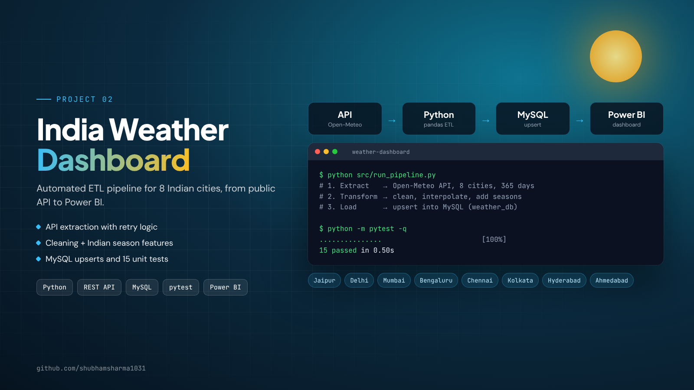
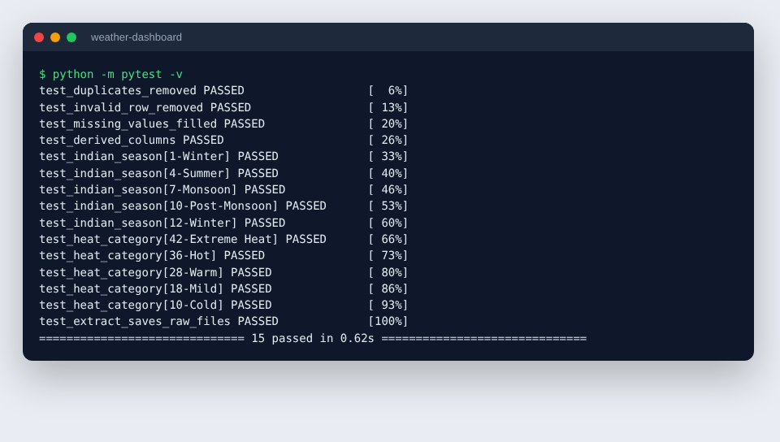

# India Weather Dashboard



An automated **ETL pipeline** that collects a year of daily weather data for 8 major Indian cities from a public API, cleans it with **Python (pandas)**, stores it in **MySQL**, and visualises it in an interactive **Power BI** dashboard.


## What it does

```
Open-Meteo API ──► extract.py ──► data/raw/*.json
                                     │
                     transform.py ◄──┘   clean, validate, add features
                         │
                         ├──► data/processed/weather_daily.csv
                         ├──► data/processed/weather_forecast.csv
                         │
                     load.py ──► MySQL (weather_db)  ──► Power BI dashboard
```

- **Cities:** Jaipur, Delhi, Mumbai, Bengaluru, Chennai, Kolkata, Hyderabad, Ahmedabad
- **History:** last 365 days (configurable), plus a **7-day forecast**
- **Metrics:** max/min/mean temperature, rain, wind, humidity, sunshine

## Dashboard



<!-- Add your Power BI screenshots after building the dashboard: -->
<!--  -->
<!--  -->

**Page 1, India Overview:** KPI cards, map of cities sized by rainfall, 7-day moving-average temperature trend, monthly rainfall by season, city × month temperature heatmap.
**Page 2, City Deep Dive:** daily temperature range, heat-category breakdown, next-7-day forecast table.

Build steps and DAX measures: [powerbi/BUILD_GUIDE.md](powerbi/BUILD_GUIDE.md)

## Data cleaning and features

`src/transform.py` handles the problems found in real API data:

| Step | Detail |
|---|---|
| Duplicates | Drop repeated (city, date) rows |
| Missing values | Rain gaps → 0 mm; other gaps interpolated within each city (max 3 days); missing mean = (max + min) / 2 |
| Validation | Drop impossible rows (min temp above max, humidity above 100%) |
| Features | `temp_range_c`, `sunshine_hours`, `is_rainy_day` (≥ 2.5 mm, IMD definition), `heat_category`, Indian `season` (Winter / Summer / Monsoon / Post-Monsoon), month, week |

The cleaning logic is covered by **unit tests** (`tests/test_transform.py`), including a mocked API test, so the pipeline can be tested without internet.

## SQL analysis

[`sql/02_analysis_queries.sql`](sql/02_analysis_queries.sql) contains 12 queries, including:

- City summary: hottest, coldest, total rain, rainy days
- Season comparison across cities
- Top 5 hottest days per city (`ROW_NUMBER`)
- 7-day moving average (`AVG ... OVER ... ROWS BETWEEN`)
- Biggest day-to-day temperature drops (`LAG`)
- Longest rainy streak per city (gaps-and-islands technique)
- Forecast vs historical monthly average (`JOIN` on a subquery)

## How to run

```bash
# 1. Install dependencies
pip install -r requirements.txt

# 2. Run the pipeline (downloads data, cleans it, saves CSVs)
python src/run_pipeline.py

# 3. Run the tests
python -m pytest -q
```

### Load into MySQL (optional)

```bash
# create the database and tables
mysql -u root -p < sql/01_create_tables.sql

# copy .env.example to .env and add your MySQL password, then:
python src/run_pipeline.py --mysql
```

Other options: `--days 90` (shorter history), `--skip-extract` (re-clean existing raw files).

Rows are **upserted** (`INSERT ... ON DUPLICATE KEY UPDATE`), so the pipeline can run every day without creating duplicates.

## Project structure

```
weather-dashboard/
├── src/
│   ├── config.py          # cities, API URLs, variables
│   ├── extract.py         # API calls with retry
│   ├── transform.py       # cleaning + feature engineering
│   ├── load.py            # MySQL upsert
│   └── run_pipeline.py    # runs all steps
├── sql/
│   ├── 01_create_tables.sql
│   └── 02_analysis_queries.sql
├── tests/
│   ├── fixtures/history_sample.json
│   └── test_transform.py
├── powerbi/BUILD_GUIDE.md
├── data/processed/        # output CSVs
├── .env.example
└── requirements.txt
```

## Data source

Weather data from [Open-Meteo](https://open-meteo.com/) (free, no API key, CC BY 4.0).

## Author

**Shubham Sharma** · [LinkedIn](https://www.linkedin.com/in/shubhamsharma1031) · [Portfolio](https://shubhamsharma1031.netlify.app/)
